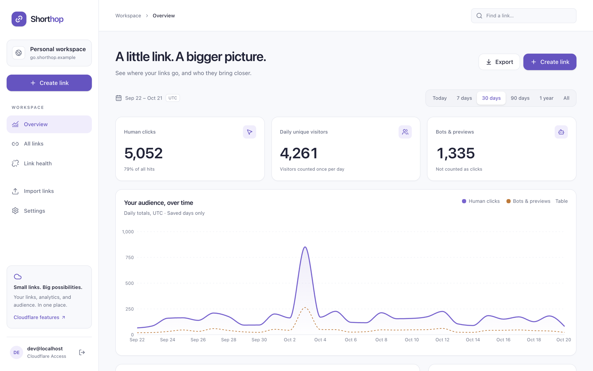
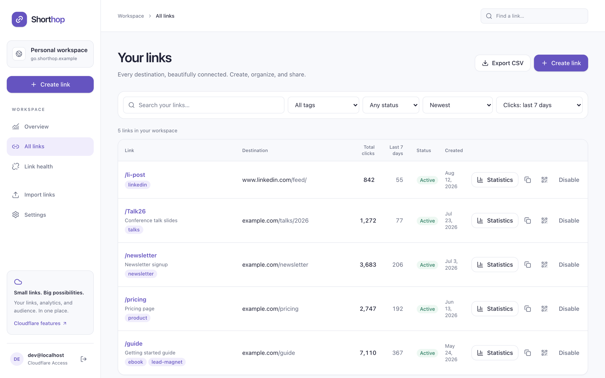
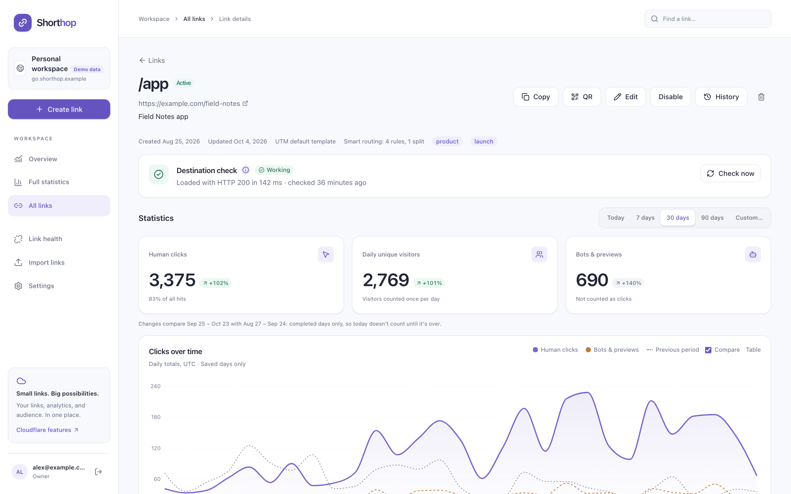
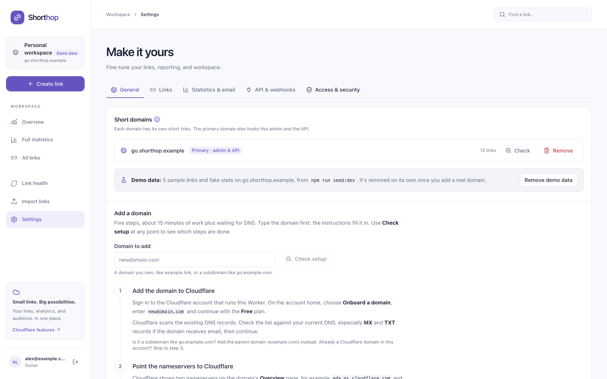
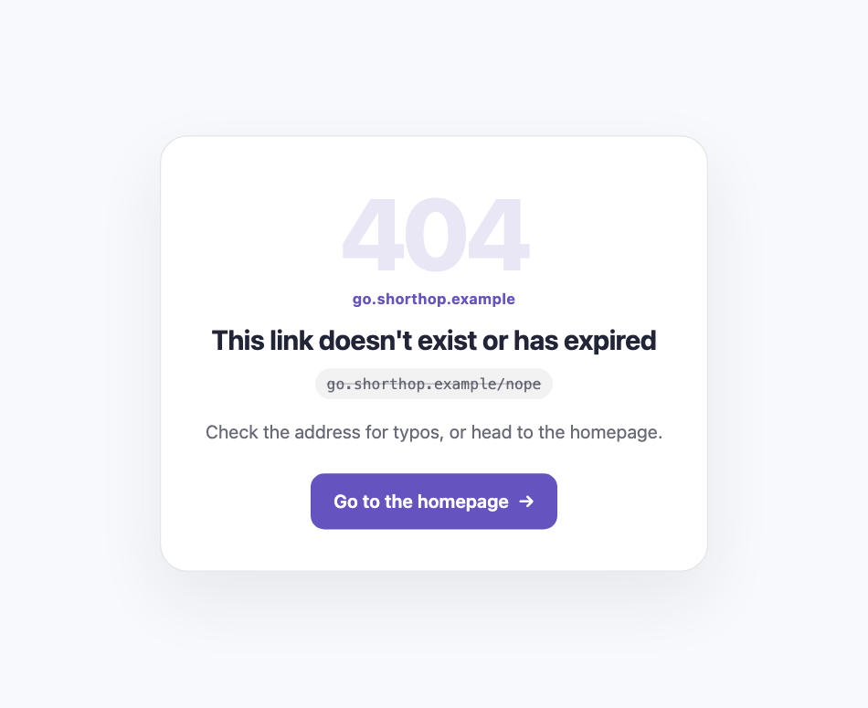

# Shorthop

[](LICENSE)
[](package.json)
[](https://workers.cloudflare.com/)

[](https://deploy.workers.cloudflare.com/?url=https://github.com/jntegz/shorthop)

A personal URL shortener that runs on one Cloudflare Worker. Short links on your own domains, click analytics without a paid geo service, a private admin, and a weekly email digest. For most personal use it fits inside Cloudflare's free allowances.

**Shorthop is built primarily for Cloudflare.** It uses Workers, Workers KV, D1, Analytics Engine, Cloudflare Access and Cloudflare Email Service directly; it isn't a portable app with a Cloudflare adapter. You need a Cloudflare account and at least one domain on it.



- **Fast redirects:** one KV read, then a `302`. Analytics is written after the response, so it never slows down or breaks a click.
- **Analytics:** country, region, city, device, OS, browser, referrer, source tag and language per click. Humans, bots and misses are counted separately. No IP addresses or cookies are stored. Unique visitors are counted with a daily hash whose random salt is deleted once the day is over. See [visitor privacy](docs/PRIVACY.md).
- **History:** a daily job saves each day into D1, so stats outlive Analytics Engine's 90-day retention.
- **Admin at `/_admin`:** create, edit, disable, expire, tag and search links; per-link stats and a full statistics page, for any date range, compared with the previous period; CSV import and export; a report of missed slugs; a custom 404 page; a page for links that no longer work, pointing visitors to a replacement; a System status page with setup checks.
- **Link history:** every change is saved as a version with who made it, and any earlier version can be restored. Deleted links can be brought back for 90 days.
- **Smart routing:** rules by device (iPhone & iPad, Android, desktop, other) and country, first match wins, with A/B splits across up to 10 weighted destinations. A simulator in the editor, and results per rule and variant on the link page. Bots and previews get the default destination; no cookies.
- **Social previews:** your own title, description and image for LinkedIn, Slack, X, iMessage and other link previews, with mockups while you edit.
- **UTM builder:** one field per parameter, saved presets, and a preview of the URL visitors land on.
- **QR studio:** colours with a contrast check, dot and corner shapes, a logo, frames with a caption, a live scan test, SVG or PNG up to 4096 px, print sheets, and a ZIP of every link's code.
- **Password-protected links and click limits:** visitors enter a password first, or a link stops after a set number of clicks, counted exactly by a Durable Object. Bots and previews don't count.
- **Link health:** destination checks for the links you pick (**Check that the destination works**, off by default), once you turn automatic checking on and choose how often. A destination that fails 3 times in a row sends one email and gets a Fix dialog.
- **Webhooks:** signed events for links created, changed or deleted, destinations down or back, and click milestones, with retries and a delivery log.
- **People and roles:** with Cloudflare Access, add people as admins, managers or users, each with their own password and the permissions you tick.
- **API at `/api`:** personal API keys for scripts, Zapier or Make and an [iOS Shortcut](docs/ios-shortcut.md). A key does only what it was given, can expire, and stops working when it's revoked.
- **Several domains:** each short domain has its own slugs and stats. The admin can live on the primary domain or on a separate host.
- **Weekly digest and alerts:** by Cloudflare Email Service, Resend, Postmark, SendGrid, Mailgun or a signed webhook.

| Links | Link statistics |
|---|---|
|  |  |
| **Short domains** | **Custom 404 page** |
|  |  |

<sub>Screenshots from local development with `npm run seed:dev` sample data.</sub>

## Quick start

There are two ways to install Shorthop.

### Deploy to Cloudflare (a few clicks)

[](https://deploy.workers.cloudflare.com/?url=https://github.com/jntegz/shorthop)

The button copies Shorthop into a new repository on your GitHub or GitLab account, creates the KV namespace and the D1 database, asks for an admin password, and deploys with Workers Builds. Both are free. You get:

- the admin at `https://shorthop.<your-subdomain>.workers.dev/_admin/`, with that password;
- password-only sign-in, and no email.

Add your domain, Cloudflare Access, statistics and email afterwards. To change the config, edit `wrangler.toml` in your copy and commit; each push deploys. The steps are in [docs/SETUP.md](docs/SETUP.md#deploy-button).

### The setup wizard (everything at once)

You need Node.js 22.12+, a Cloudflare account, and a domain whose DNS is on Cloudflare (a spare subdomain of a domain you already have works too).

```sh
git clone https://github.com/jntegz/shorthop.git
cd shorthop
npm ci
npx wrangler login
npm run setup
```

`npm run setup` asks for your domains, how to protect the admin, your admin password and how to send email. It then creates the KV namespace and D1 database, writes `wrangler.jsonc`, uploads the secrets, deploys, and checks the result. It's safe to re-run, and parts of it can be run on their own (`npm run setup -- email`, `-- access`, `-- password`, ...). Add `--dry-run` to see what it would do without changing anything.

The full manual, including every Cloudflare dashboard step, is in **[docs/SETUP.md](docs/SETUP.md)**.

## Documentation

- **[Setup manual](docs/SETUP.md):** [requirements](docs/SETUP.md#what-you-need), [the Deploy to Cloudflare button](docs/SETUP.md#deploy-button), [domains](docs/SETUP.md#domains), [Cloudflare Access](docs/SETUP.md#access), [email](docs/SETUP.md#email), [troubleshooting](docs/SETUP.md#troubleshooting), [updating](docs/SETUP.md#updating), [moving from another shortener](docs/SETUP.md#import), [uninstalling](docs/SETUP.md#uninstalling)
- **[Cloudflare free tier](docs/CLOUDFLARE-FREE-TIER.md):** what each service allows and what Shorthop uses
- **[iOS Shortcut](docs/ios-shortcut.md):** shorten a link from the share sheet
- **[Visitor privacy](docs/PRIVACY.md):** what Shorthop records about visitors, for your privacy notice
- **[Security](SECURITY.md):** reporting a vulnerability, protections and a hardening checklist

## Costs

Shorthop doesn't assume a paid plan. On Workers Free you get 100,000 requests a day, 1,000 KV writes a day (each link save is one), and 10 ms of CPU per request; the setup tunes the admin password hash to fit. Cloudflare Access is free for up to 50 users, and Email Service is free when sending to a verified address in your own account. Workers Paid ($5/month) raises the limits. See [docs/CLOUDFLARE-FREE-TIER.md](docs/CLOUDFLARE-FREE-TIER.md) for every service and its allowance.

On Free, the daily requests are a hard cap for the whole account: once they're used up, every short link fails until midnight UTC, and anyone can use them up by sending requests. Add a rate-limiting rule ([SECURITY.md](SECURITY.md#daily-cap)), and choose Paid if your links must not go down.

## Security model

- **Admin:** Cloudflare Access (verified in the Worker, not only at the edge) plus a password, by default. Password-only sign-in is possible, but only with the exact setting `ADMIN_AUTH="password"`; any other gap in the configuration keeps the admin closed. See [SECURITY.md](SECURITY.md).
- **People:** owners (`ADMIN_EMAIL`) use the admin password; everyone else has their own, chosen from a one-time invite link. Every API route has a permission rule, checked in the Worker, and a route without one is refused. Without Access there's only the owner.
- **Password login:** at least 9 characters (the setup generates a 32-character one by default), PBKDF2-SHA256, a signed `__Host-` session cookie bound to the signed-in identity, lockouts per network that double with each lockout, and a global brake. IP addresses are never stored, only a keyed hash.
- **API:** personal API keys, stored only as a SHA-256 hash and limited to what their owner may do; failed attempts lock the network. The older `API_TOKEN` secret still works, and by default it can read and create links but not change or delete them (`API_TOKEN_SCOPE`).
- **Secrets:** stored as Wrangler secrets. The setup sends them to Cloudflare through stdin and never writes them to disk. The admin never displays them. A Deploy to Cloudflare install keeps its generated session secret and visitor salt in D1 until you set your own.
- **Redirects:** targets must be `https://` and can't point back at the shortener.

## Local development

```sh
npm ci
npm run setup -- local        # writes .dev.vars with random dev secrets
npm run db:migrate:local
npm run seed:dev              # optional: sample links and 120 days of fake stats
npm run dev                   # http://localhost:5173/_admin/
```

Without `wrangler.jsonc`, local development uses `wrangler.example.jsonc`. On localhost, `DEV_AUTH_BYPASS=1` skips Cloudflare Access (the password is still asked for if one is set). It's ignored on every other host.

```sh
curl -sI 'localhost:5173/guide?s=li'                               # 302 with UTM parameters
curl -sI localhost:5173/nope                                       # the 404 page
curl 'localhost:5173/cdn-cgi/handler/scheduled?cron=15+1+*+*+*'    # run the daily rollup
curl 'localhost:5173/cdn-cgi/handler/scheduled?cron=*/30+*+*+*+*'  # run the destination checks (real requests)
```

Set `DEV_AUTH_EMAIL` in `.dev.vars` to see the admin as someone from Settings → People.

Analytics Engine can't be queried locally, so "today" stays empty in dev. Earlier days come from D1, which the seed script fills.

### Checks

```sh
npm run typecheck        # tsc -b across shared, worker, admin and scripts
npm test                 # Workers-runtime tests (Vitest) and Node tests for the setup
npm run build            # needs wrangler.jsonc, or SHORTHOP_ALLOW_EXAMPLE_CONFIG=1
npm run config:example   # rewrite wrangler.example.jsonc and wrangler.toml after changing the config template
npm run types            # then regenerate worker-configuration.d.ts
```

## Configuration

`npm run setup` writes `wrangler.jsonc` (gitignored) from the template in `scripts/setup/template.ts`; `wrangler.example.jsonc` shows its shape with placeholder values. `wrangler.toml` is the Deploy to Cloudflare button's config, from the same template; a `wrangler.jsonc` wins over it. Vars live in the config; secrets are Wrangler secrets.

| Name | Kind | Purpose |
|---|---|---|
| `SHORT_DOMAINS` | var | Short domains, primary first (`go.example.com,go.example.net`). Each has a custom domain route |
| `ADMIN_HOST` | var | Optional separate host for the admin and the API. Empty: the primary domain |
| `FALLBACK_URL` | var | Where `/` goes, and clicks when the link store can't be read. Referrals from its host count as source "site" |
| `ADMIN_AUTH` | var | `access+password` (default; empty means the same) or `password`. Anything else locks the admin |
| `ACCESS_TEAM_DOMAIN`, `ACCESS_AUD` | var | Cloudflare Access team domain and application AUD tag |
| `ADMIN_EMAIL` | var | The Access identities allowed in (comma-separated) |
| `CF_ACCOUNT_ID` | var | For Analytics Engine SQL queries |
| `AE_DATASET` | var | The Analytics Engine dataset name (letters, digits, `_`) |
| `WORKERS_PLAN` | var | `free` or `paid`; System status checks the password hash cost against it |
| `API_TOKEN_SCOPE` | var | `create` (default): the API token reads, creates links and imports new ones. `full`: it can also change and delete links and settings. Anything else means `create` |
| `KV_CACHE_TTL` | var | Edge cache for slug lookups in seconds (default 60; values under 30 fall back to 60) |
| `DIGEST_PROVIDER` | var | Default delivery: `cloudflare`, `resend`, `emailit`, `postmark`, `sendgrid`, `mailgun`, `custom`, `webhook` or `off`. Settings → Statistics & email → Weekly digest → **Set up email** can override it (and `DIGEST_FROM`) without a deploy |
| `DIGEST_FROM`, `DIGEST_TO` | var | Sender and the only recipient of the digest and alerts |
| `DIGEST_MAILGUN_DOMAIN`, `DIGEST_MAILGUN_REGION` | var | Mailgun only |
| `DIGEST_CUSTOM_AUTH`, `DIGEST_CUSTOM_BODY` | var | Custom email API only, optional: auth header and JSON body template ([docs/SETUP.md](docs/SETUP.md#custom)) |
| `DEV_AUTH_BYPASS` | var | `1` only in `.dev.vars`: skips Access on localhost. Ignored on any other host |
| `DEV_AUTH_EMAIL` | var | With `DEV_AUTH_BYPASS` only: see the admin as this person from Settings → People. Empty: an owner |
| `API_TOKEN` | secret | Optional, from before personal API keys: a Bearer token for `/api`, limited by `API_TOKEN_SCOPE`. New installs don't get one |
| `VISITOR_SALT` | secret | Mixed into the visitor hash, together with a random salt per day that's deleted once the day is over. Without it, one is generated and kept in D1 |
| `ADMIN_PASSWORD_HASH` | secret | PBKDF2 hash of the owners' password |
| `ADMIN_PASSWORD` | secret | The owners' password in plain text, at least 9 characters: what the Deploy to Cloudflare button sets. Used only without `ADMIN_PASSWORD_HASH` |
| `SESSION_SECRET` | secret | Signs admin sessions, link-password cookies and webhook secrets; rotating it logs everyone out and makes webhook secrets unreadable. Without it, one is generated and kept in D1 |
| `CF_ANALYTICS_TOKEN` | secret | Optional: API token with Account Analytics Read, for stats |
| `RESEND_API_KEY`, `EMAILIT_API_KEY`, `POSTMARK_API_KEY`, `SENDGRID_API_KEY`, `MAILGUN_API_KEY` | secret | Each provider's own API key. An older `DIGEST_API_KEY` still works, for the provider named in `DIGEST_PROVIDER` only |
| `DIGEST_CUSTOM_URL`, `DIGEST_CUSTOM_API_KEY` | secret | Custom email API only: HTTPS endpoint and key |
| `DIGEST_WEBHOOK_URL`, `DIGEST_WEBHOOK_SECRET` | secret | Webhook endpoint and its HMAC key |

## How requests are routed

| Path | Handled by |
|---|---|
| `/{slug}` | KV lookup of `<domain>/<slug>`, then a 302 (to the destination smart routing picks), or the 404 page (logged as a miss). A password-protected link shows its password form first (POST to the same path); a link at its click limit shows a "limit reached" page; preview crawlers get the link's social preview. A link marked "no longer working" gets a 410 page: a button to its replacement link, or, without a usable one, a redirect after a few seconds to the site set in Settings |
| `/_og/<key>` | An uploaded social-preview image. Also served on `ADMIN_HOST`, for the editor |
| `/` | 302 to `FALLBACK_URL` (or to `/_admin/` on a separate admin host) |
| `/_admin` | 301 to `/_admin/` |
| `/_admin/login`, `/_admin/logout` | The password step: a server-rendered form, lockouts, signed session cookie |
| `/_admin/invite/<token>` | A one-time invite link: the invited person chooses their password |
| `/_admin`, `/_admin/**` | Access JWT (unless password-only) and the password session, then the admin app with a strict CSP |
| `/_admin/assets/*`, `/robots.txt`, `/favicon.ico` | Static assets, served without running the Worker |
| `/_admin/api/*` | The API for the admin app: CSRF check, identity and session |
| `/api/*` | The same API with a personal API key, or the `API_TOKEN` secret (read and create only, unless `API_TOKEN_SCOPE` is `full`) |
| `/health` | `ok` |

Asset routing uses `html_handling: "none"`, `not_found_handling: "none"` and `run_worker_first: ["/_admin/*", "!/_admin/assets/*"]`. Don't turn on SPA mode: browser navigations to slugs would stop reaching the Worker.

## Project layout

```
_admin/index.html          admin app entry (builds to dist/client/_admin/)
migrations/                D1 schema
public/                    robots.txt, favicon, brand icon
scripts/setup/             npm run setup: the wizard, config template, deploy guard
scripts/                   import, check-slugs, seed-dev, hash-password
src/shared/                slug rules, domains, UTM handling, schemas, API types, brand, cron schedule
src/worker/index.ts        entry: request dispatch and cron handlers
src/worker/redirect.ts     the click path
src/worker/auth.ts         Access JWT, sign-in mode, session, API key and token checks
src/worker/permissions.ts  the permission rule for every API route
src/worker/users.ts        people, roles and personal API keys
src/worker/secrets.ts      session secret and visitor salt generated in D1 when unset
src/worker/history.ts      link versions: record, list, restore deleted, prune
src/worker/link-check.ts   destination checks: safe fetching, scheduling, alert email
src/worker/webhooks.ts     signed webhook events, retries and the delivery log
src/worker/click-cap.ts    the click-limit Durable Object
src/worker/health.ts       System status, setup checks and alert emails
src/worker/api/            links, stats, settings, checks, previews, UTM, QR, webhooks, people and keys routes
src/client/                admin app (React, Vite, Tailwind, TanStack Query, Recharts)
test/                      Workers-runtime tests; test/node: setup tests
docs/                      SETUP.md, CLOUDFLARE-FREE-TIER.md, PRIVACY.md, ios-shortcut.md, images/ (README screenshots)
```

## Design notes

- **302, not 301:** browsers cache 301s, which would skip the Worker on repeat clicks, lose the data, and make links impossible to retarget.
- **A 60-second KV cache:** a cached value, including a cached "not found", lives until its TTL ends. At 60 seconds, edits reach everyone within about a minute.
- **Daily uniques:** the visitor hash covers the IP address, user agent and date, with a secret salt and a random salt for that day. The daily job deletes each day's salt once the day is over, so afterwards nobody, the owner included, can work out whose visit a hash was. Hashes can't be followed across days. Stats show the sum of daily uniques.
- **Imported links** keep `http://` targets and get no UTM tags, so they redirect exactly as before. New links must be `https://`.
- **Bots** still get the redirect but are counted separately, by user agent, HEAD and prefetch requests, and datacenter networks. iCloud Private Relay is deliberately not flagged. A visitor that misses 5 or more different paths in one UTC day counts as a scanner, and that can include you while you test typos. Chrome prerendering an address as you type it counts as a bot too. The Misses page’s **Latest misses, as recorded** shows how each recent miss was counted.

## FAQ

**Why does it redirect with 302 and not 301?**
Browsers and some proxies keep a 301 forever. After the first click, the browser would skip Shorthop: changing a link's target, disabling it or letting it expire would no longer reach people who clicked before, and their repeat clicks wouldn't be counted. A 302 keeps every link editable and every click measured. Search engines still follow 302s to the target. There's no per-link 301 option for these reasons.

**What does it cost?**
Usually nothing. A personal shortener fits inside Workers Free (100,000 requests and 1,000 link saves a day). See [Costs](#costs) and [docs/CLOUDFLARE-FREE-TIER.md](docs/CLOUDFLARE-FREE-TIER.md).

**How do I add or remove a domain?**
On an install from the Deploy to Cloudflare button, edit `wrangler.toml` in your copy of the repository: add the domain to `SHORT_DOMAINS` and a route for it, and commit ([details](docs/SETUP.md#deploy-button)). Otherwise, add one with `npm run setup -- domains` and deploy; Settings → Short domains walks through the DNS and checks it live. To remove one, use **Remove** in Settings → Short domains: it deletes the domain's links, stats and missed paths after you type the domain name. Then take it out with `npm run setup -- domains` (or edit `SHORT_DOMAINS` and `routes` in `wrangler.jsonc`) and deploy. The Worker can't change its own configuration.

**What are the password rules?**
At least 9 characters. The setup offers a generated 32-character password by default, which is the better choice, especially with [password-only sign-in](docs/SETUP.md#password-only). Wrong passwords are slowed down by per-network lockouts and a global brake.

**How long are stats kept?**
Analytics Engine keeps raw clicks for about 90 days; a daily job copies each finished day into D1, where it stays until you delete it. "Today" is read live from Analytics Engine.

**What is the demo data in my local admin?**
`npm run seed:dev` fills your local database with five sample links and 120 days of fake stats, so the admin has something to show. It never touches a deployed Worker. Remove it in Settings → Short domains; it also goes on its own once you configure a real domain.

**Can I use it without Cloudflare?**
No. Shorthop is built on Workers, KV, D1 and Analytics Engine directly.

## Author

Built by [Jan Tegze](https://jantegze.com).

## License

[MIT](LICENSE)
